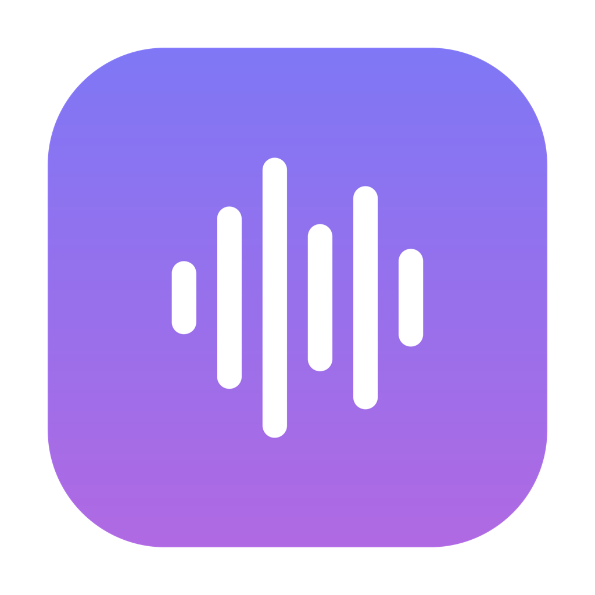
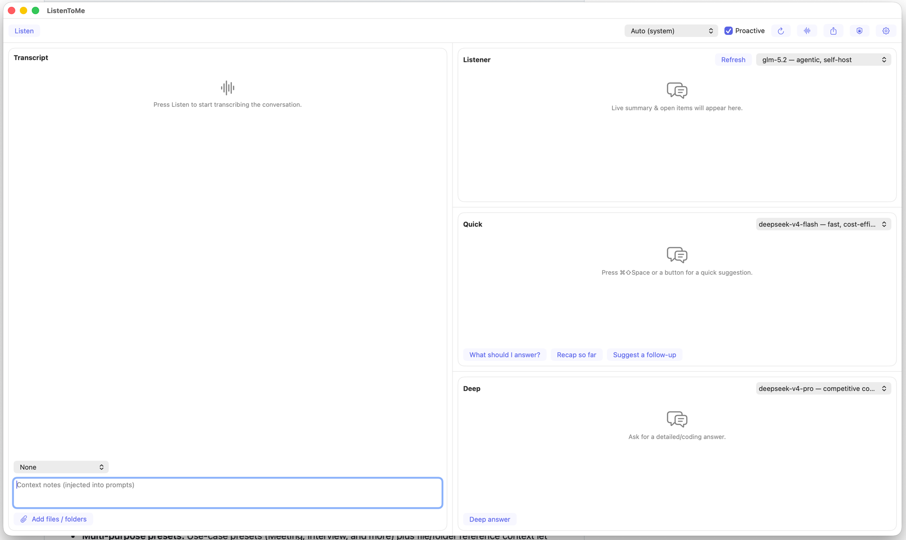
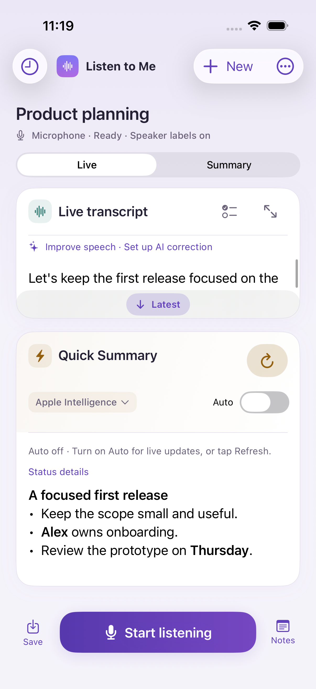
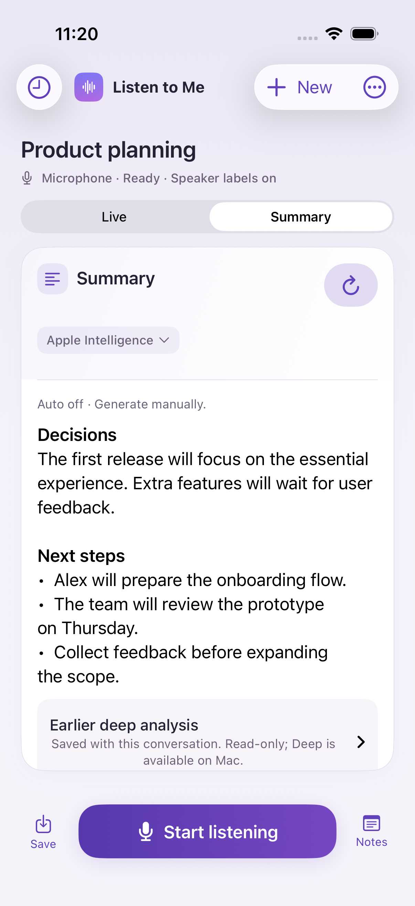
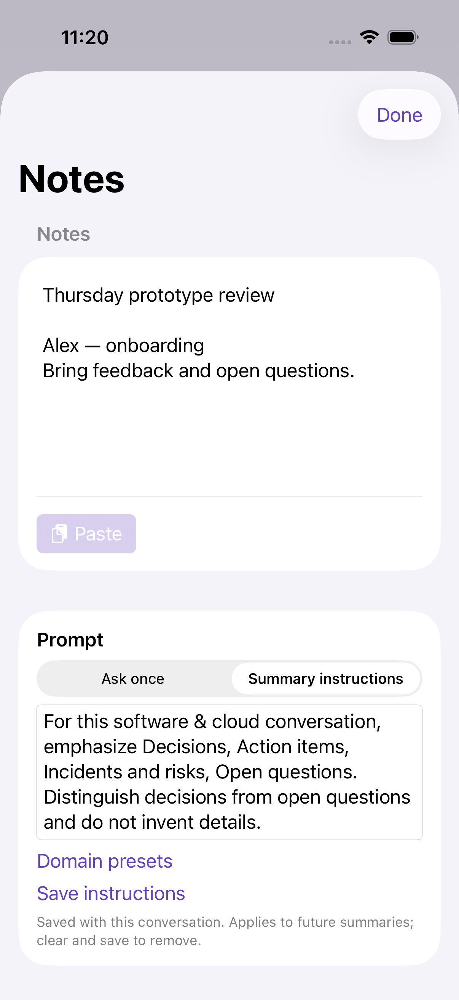
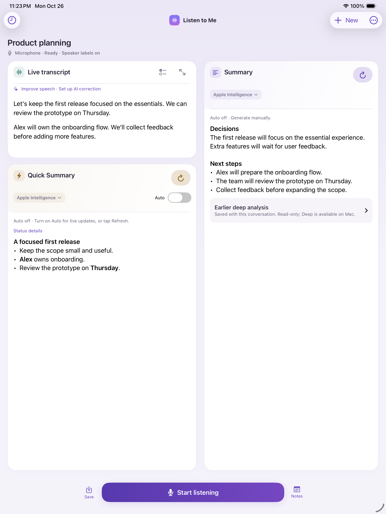
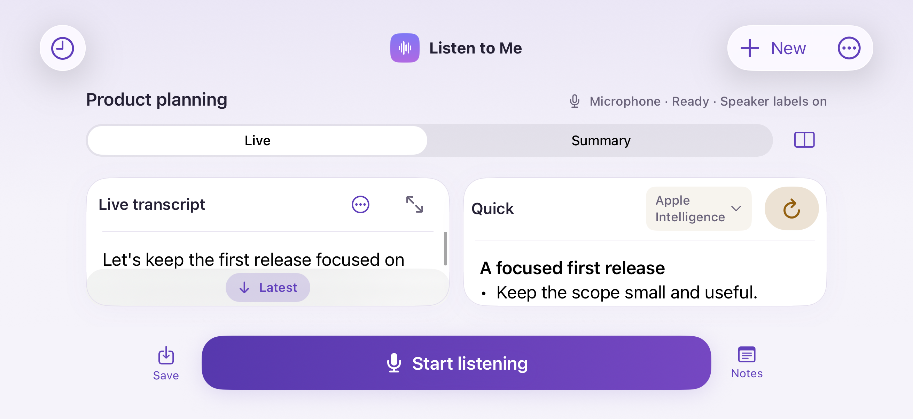
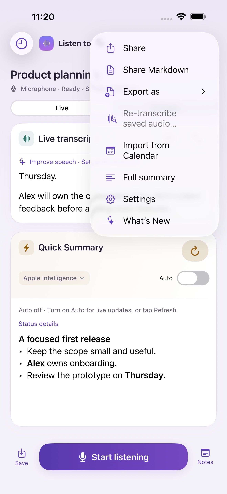

<div align="center">



# ListenToMe

**The free, open-source, fully on-device meeting copilot for macOS — with a private capture-and-recall companion for iPhone and iPad. Bring your own model, stay private, shape it to any conversation.**

[](https://github.com/tomqwu/ListenToMe/actions/workflows/ci.yml)


[](LICENSE)


</div>

ListenToMe listens to your mic and the other participants' system audio, transcribes live, and gives
real-time AI help — all on your Mac. It runs transcription on-device with Apple's SpeechAnalyzer and
routes AI inference through [Ollama](https://ollama.com), so with a local model **your audio and
transcript never leave the machine**.

## iPhone and iPad

**The iPhone and iPad app is a personal capture and recall companion, not a port of the Mac copilot.**
It transcribes what the device's own microphone hears — an in-person conversation, a lecture, an
interview, a phone on the table — summarizes it on-device by default, and keeps conversations local,
searchable and shareable. It is deliberately not a copilot for calls or video meetings: iOS does not
let an app capture another app's audio, so the dual-channel "You / Others" experience stays
macOS-only, and there is no Mac↔iOS sync. See
[what this app is for](docs/IOS.md#what-this-app-is-for),
[parity with macOS](docs/IOS.md#parity-with-macos) and
[the version policy](docs/IOS.md#version-policy).

The standalone iOS/iPadOS 26 app is the **ListenToMeIOS** target: microphone transcription, a live
transcript with Quick Summary plus a Summary tab (Deep is macOS-only; a Deep analysis saved by an earlier
build stays readable under **Earlier deep analysis**), an opt-in **Auto** (off by default; with Ollama, a
cloud AI service or an OpenAI-compatible server) that refreshes Quick Summary and Summary as people
talk, **Summarize selection** for just
the lines you pick (Select, or touch and hold a line → Summarize from here), context-aware suggested questions
you can ask in one tap, local conversations that name themselves, with on-device semantic search, "Ask
your history" and **Delete all conversations**, photo/file
attachments, Apple Notes and share-sheet imports, calendar import with e-mail and join-link
redaction, Markdown sharing, **Export as** Markdown, plain-text, SRT/WebVTT subtitle or JSON files with
timestamps, and an opt-in **Save to folder** that writes each conversation as a
Markdown note into a folder you pick in Files, such as an Obsidian vault, and an opt-in **Save audio recordings** that keeps
each recording's microphone audio on the device for playback from its transcript lines. On-device speaker identification (on by default; turn it off in
Settings) labels transcript lines Speaker 1, Speaker 2… for the people one phone hears, and you can
rename them; its models download once from `huggingface.co`. The [speaker fix](docs/speaker-identification.md) in TestFlight 1.18.1
uses a recording-scoped streaming model; similar voices can still merge in group conversations. The transcription language defaults to
Automatic: the phone detects the spoken language on-device from the first seconds of speech and, if it
differs from the device language, switches and transcribes the recording again; it re-checks about once
a minute while people talk, so a meeting that changes language part-way switches too (its small Whisper
model downloads once from `huggingface.co`; audio never leaves the device). Choose on-device Apple
Intelligence — the default on capable devices — or Ollama: Ollama Cloud with your own key, or an
Ollama server you run on your own network — or a cloud AI service with your own key (OpenAI,
Anthropic Claude, Google Gemini, DeepSeek, OpenRouter, Groq, Mistral, xAI), each labelled "Sends your
transcript to <vendor>" — or any OpenAI-compatible server you enter (LM Studio,
vLLM, llama.cpp, OpenRouter), labelled "your server" on your own network and "may leave this device"
elsewhere. Domain vocabularies (Medical, Legal, Software & Cloud, Engineering, Finance, Sales,
Education & Research) and your own **My terms** list help recognition, AI speech correction and
summaries on both platforms; after about a minute of speech the phone may suggest one, decided on the
device. Meeting use-case presets, reference files, audio-file import and WhisperKit transcription are macOS-only.
Editable domain prompt presets are available on both platforms.
The public iPhone/iPad app is 1.18.1. The latest TestFlight beta is **1.19.1 (39)**
([October 27 release](https://github.com/tomqwu/ListenToMe/releases/tag/ios-v1.19.1-build39)), including the Apple Watch companion.
[Watch installation and limits](docs/watch-beta.md) and [native previews](docs/images/watch/1.19.1/README.md)
are available; physical Watch acceptance remains pending. All 49 fresh release images are inspected;
The [1.19.1 App Store draft](docs/releases/ios-1.19.1-build39-media.json) now has 60 processed screenshots across both English locales, including Watch and landscape Duo; their downloaded pixels and order are verified. The draft has not been submitted, so the public listing remains unchanged.
See [iOS setup, validation and distribution](docs/IOS.md). Device and language support are checked
per feature; Apple Intelligence is independent of recording. The [compatibility support](docs/device-compatibility.md)
includes local dictation fallback for compatible older iPads and explicit unavailable-feature recovery
in the 1.18.0 beta. Current-source physical-device acceptance remains pending.

```sh
make ios-build
make ios-test
```

## Screenshots

**macOS**



**iPhone and iPad** (1.18.2)

<p>




</p>



Live transcript with Quick Summary · Summary · conversation prompts · iPad workspace · two-pane iPhone.


Native simulator captures use synthetic content; [capture provenance](docs/images/ios/release-1.18.2-en-US.json).
The complete four-device release set is preserved locally for the next authorized App Store submission.

## Why ListenToMe

- **On-device & private.** Transcription runs locally via Apple SpeechAnalyzer, and AI help can run
  entirely against a local Ollama model — audio and transcript need never leave your Mac.
- **Bring your own model.** Pick any Ollama model, local or cloud, a cloud AI service with your own
  key (OpenAI, Claude, Gemini, DeepSeek, OpenRouter, Groq, Mistral, xAI), or point the app at any
  OpenAI-compatible server (LM Studio, vLLM, llama.cpp, OpenRouter), instead of being locked to a
  single undisclosed backend LLM.
- **Multi-pane, multi-model.** Four panes, and each AI pane runs its own model — picked from the
  left status rail — run a fast model for live notes and a stronger one for deep analysis, side by
  side, in the same conversation.
- **Multi-purpose presets.** Use-case presets (Meeting, Interview, and more) plus file/folder
  reference context let one app serve meetings, interviews, study, support, and beyond.
- **Free & open-source.** No subscription, no seat pricing, no closed pipeline — the code is open
  for inspection.

## How it compares

Distilled from [`docs/competition-analysis.md`](docs/competition-analysis.md); facts are stated as of
2026 and qualified where they couldn't be confirmed from a primary source.

| Tool | On-device | BYO model | Multi-pane | Presets | Price |
|---|---|---|---|---|---|
| **ListenToMe** | Yes — transcription + local AI | Yes — Ollama local + cloud, OpenAI/Claude/Gemini/DeepSeek/OpenRouter/Groq/Mistral/xAI with your key, any OpenAI-compatible server | Yes — per-pane model | Yes | Free & open-source |
| Granola | No — local capture, cloud ASR + AI | Reported, unconfirmed | No | Templates (29+) | Free; ~$14–35/user/mo |
| Otter.ai | No — cloud | No | No | Limited | Free; ~$8–30/user/mo |
| Fireflies.ai | No — cloud | No (export via MCP) | No | Limited | Free; ~$10–39/seat/mo |
| Cluely | No — cloud | No / undisclosed | No | No | Free; $19.99–149.99/mo |
| MacWhisper | Yes — on-device by default | Yes — BYO keys (Gumroad) | No | Prompts | Free; ~$69 one-time / subs |
| Natively (OSS) | Yes — STT on-device; AI local or cloud | Yes — Gemini, OpenAI, Claude, Groq, Ollama | No | No | Free personal; paid Pro |
| Hyprnote (OSS, now Anarlog) | Partial — on-device STT option; AI local or cloud | Yes — Ollama, LM Studio, OpenRouter | No | No | Free (MIT); paid enterprise |
| Meetily (OSS) | Yes — local by default; cloud LLMs optional | Yes — Ollama local, or cloud APIs | No | No | Free (MIT); paid Pro/Enterprise |

## Features

**Live capture & transcription**
- Dual-channel capture: your mic + the other participants' system audio, source-labeled.
- On-device transcription via **Apple SpeechAnalyzer** (default) or the legacy **SpeechRecognizer**.
- **Transcription-language** picker listing every language your Mac can transcribe on-device, and
  **audio-file import** to transcribe an existing recording.
- **Survives device changes:** connecting AirPods, docking/undocking or sleep/wake re-installs the
  microphone tap and restarts capture in place ("Mic: input changed — resumed"); a stopped
  system-audio stream gets the same one-shot restart. If a channel really cannot be recovered, the
  capture line turns red with ⚠️ instead of leaving a dead channel under a running timer.
- **No silent recordings:** Listen checks microphone authorization first. If access is denied (or
  restricted by device management), the app explains it and offers **Open Settings** rather than
  reporting "Mic: active" while recording silence.

**Four-pane AI copilot**
- **Transcript** — live, source-labeled, no model.
- **Summary** (the Listener) — rolling summary plus open questions / action items.
- **Quick** — fast suggestions on the global hotkey, buttons, or proactively when someone asks a
  question. **Proactive** (the checkbox in the Quick pane header, on by default) answers a finalized
  question from **Others** automatically: your own questions never trigger it, repeat questions are
  debounced, and an answer you asked for is never cut off mid-stream. It is independent of **Auto**,
  which writes the periodic recap.
- **Deep** — on-demand, detailed long-reasoning answers.
- On-demand Quick and Deep answers stay grounded in the meeting even with Auto off (the default).
  They read the whole conversation when it fits — up to about 16,000 characters (~18 minutes of
  speech) for Quick and 32,000 for Deep on Ollama and cloud models, and whatever fits Apple
  Intelligence's small window. In a longer meeting the Listener summary stands in for exactly the
  speech it has read; of the speech it has not read (with no summary, the whole meeting), the start
  and the most recent part are sent, at no extra model call. A summary that stopped at the output
  limit is sent but never treated as covering anything. The pane says what was used, for example
  "Using the Listener summary of the first ~10 min, the ~4 min after it and the last ~12 min of the
  conversation (~19 min in between left out)." Listener context is shared into Quick and Deep
  whenever a summary exists (after **Refresh**, or automatically with **Auto**).
- An answer or summary that stops at the model's output limit keeps its text, and the pane says "The
  answer was cut off at the model's output limit."
- **Auto** writes Quick, Listener and Deep automatically while you listen, from the same
  speaker-labeled transcript and under the same settings as a manual Generate: your AI
  response-language and the selected use-case preset. Attached reference files reach automatic
  Deep only, matching manual Deep; automatic Quick and Listener get none. Auto output cannot flip
  the pane's language or drop your persona.
- **Suggested · from context** chips: with Auto on, two or three one-tap prompts drawn from the
  conversation ("Counter the net-30 ask", "Summarize pricing options") appear above the fixed Quick
  actions. They come from the Auto Quick check that already runs — no extra model call — so there are
  none with Auto or AI off. A tap sends the literal text through Quick (right-click for **Ask in
  Deep**); nothing is sent by itself. Chips refresh at most every 20 seconds, a tapped chip is not
  suggested again, and a new conversation, a model change, Auto off or AI off clears them; Stop keeps them.
  On iPhone and iPad the chips sit under Quick Summary after an Auto check or a manual refresh
  (including Apple Intelligence's); a tap shows the answer in a small Ask card under Quick Summary —
  the question in bold, the answer below, Close to dismiss — and never replaces a summary.
- An answer you asked for in Quick ("Draft reply", "Key terms"…) stays on screen: the automatic
  recap keeps updating behind it and **Show recap** switches back. Typing in Notes never cancels a
  running automatic review, and a review that exceeds its deadline says so instead of repeating the
  same request — the deadline scales with the conversation's length and is exactly twice as long for
  Deep. A dropped or stalled connection is still retried normally.

**Bring-your-own-model**
- Each AI pane's model is set from a **model picker in the left status rail**, listing chat-capable
  models discovered from your Ollama server — local and Ollama-cloud (`:cloud`) models alike.
- **OpenAI-compatible servers.** Choose the **OpenAI-compatible** AI mode and enter a server URL —
  LM Studio (`http://localhost:1234/v1`), vLLM, llama.cpp, Ollama's own `/v1` API, or
  `https://openrouter.ai/api/v1` — plus an optional key. The pane pickers list the server's
  `/v1/models`; panes stay unset until you pick a model, because a hosted catalog can list hundreds
  of vendors' models. See [OpenAI-compatible servers](#openai-compatible-servers).
- **Cloud AI services.** Choose **Cloud AI service**, pick OpenAI, Anthropic Claude, Google Gemini,
  DeepSeek, OpenRouter, Groq, Mistral or xAI Grok and paste your own key; each pane's model is your pick
  from that vendor's list. See [Cloud AI services](#cloud-ai-services).
- **AI response-language** setting, independent of the transcription language.

**Make it yours**
- **Use-case presets** (Meeting, Interview, etc.) tune the copilot's behavior.
- **Domain vocabularies and My terms** (Settings): Medical, Legal, Software & Cloud, Engineering,
  Finance, Sales and Education & Research presets plus your own list of names, products and jargon.
  They supply on-device recognition hints, steer summaries and answers, and lay summaries out by domain; a
  banner offers one when a conversation sounds like it, and right-clicking a transcript line adds a
  word to My terms. See [Vocabularies](#vocabularies).
- **File & folder reference context** with a configurable token budget.
- **Export** as Markdown, plain text, SRT or WebVTT subtitles, or versioned JSON, plus recap and PDF,
  in files named after the conversation (`Weekly sync 2026-10-23 1435.srt`). Lines carry `[mm:ss]`
  timestamps where the engine reports them (SpeechAnalyzer, WhisperKit and iPhone recordings; Apple Watch recordings
  in the Watch beta); see
  [Export formats](docs/export-formats.md).
- **Save to folder** (off by default, Settings): after each conversation stops, writes one
  Obsidian-friendly Markdown note (YAML front matter, summary, notes, timestamped transcript) into a
  folder you choose, and updates the same note when summaries or the title change.
- **Save audio recordings** (off by default, Settings): keeps each recording's microphone and system
  audio as two `.m4a` files beside the conversation on this Mac, for playback and sharing from History.
  Saved only for conversations History keeps; Clear history, Discard, Close without saving and
  **Delete all saved audio** remove them; optional automatic deletion after 7, 30 or
  90 days.
- **Re-transcribe saved audio**: open a saved conversation, choose **More → Re-transcribe saved audio**,
  select a language and preview a new on-device recognition pass. Mac offers Apple or WhisperKit;
  iPhone and iPad use Apple. **Replace transcript** keeps notes, attachments and summaries, while
  replacing all transcript lines and resetting speaker names and corrections. **Keep original**
  leaves the conversation unchanged.
- **First-run onboarding**, a global **⌘⇧Space** hotkey for instant suggestions, and keyboard
  equivalents for every frequent action (see [Keyboard shortcuts](#keyboard-shortcuts)).

## Requirements

- **macOS 26+**
- [Ollama](https://ollama.com) — running locally for local models, and/or an Ollama Cloud API key
  for cloud models. The app auto-picks an installed model on first launch. Alternatively, any
  OpenAI-compatible `/v1/chat/completions` server (LM Studio, vLLM, llama.cpp, OpenRouter), or your
  own API key for a cloud AI service (OpenAI, Anthropic, Google Gemini, DeepSeek, OpenRouter, Groq,
  Mistral, xAI).
- To build from source: Xcode 26+, `brew install xcodegen` (optionally `swiftlint`, `xcbeautify`).

## Install

**Download (recommended)**
- Grab the notarized `.dmg` from [Releases](https://github.com/tomqwu/ListenToMe/releases),
  open it, and drag **ListenToMe** to **Applications**. See [`CHANGELOG.md`](CHANGELOG.md) for
  what changed in recent macOS and iOS releases.
- The latest macOS release is **1.4.4** (2026-09-14), and macOS releases are paused for now. This
  README describes `main`: Mac features merged since 1.4.4 — among them Cloud AI services,
  OpenAI-compatible servers, vocabularies, Save to folder, saved audio, the new export formats and
  History search by meaning — are listed under
  [macOS (unreleased since 1.4.4)](CHANGELOG.md#macos-unreleased-since-144) and are available only
  when you build from source until the next release.

**Build from source**
```bash
brew install xcodegen
make run
```

## Build & run

```bash
make test     # run the ListenToMeCore test suite (unit + integration)
make build    # generate the Xcode project and build the app
make run      # build and launch
make pre-push # lint + tests + build (the CI-equivalent gate)
```

Optional: copy `signing.local.mk.example` to `signing.local.mk` (gitignored) and set your
code-signing identity so granted macOS permissions (mic/screen) persist across
rebuilds (otherwise each rebuild re-asks). Find it via `security find-identity -v -p codesigning`.

On first run, grant Microphone, Speech Recognition and Screen Recording (for system audio) in
System Settings → Privacy & Security. The global hotkey needs no Accessibility permission. The app shows an
onboarding sheet on first launch; grant these permissions from **More → Permissions…** at any time
after that. **Quit & Reopen** (offered after granting Screen Recording) finalizes and saves the
current conversation first — if you cancel that save, nothing is relaunched, so you never end up
with two copies of the app competing for the microphone. Microphone access is also re-checked every
time you press **Listen**: without it macOS
hands the app silence rather than an error, so the app refuses to start and points you at the
Microphone pane (a managed/restricted Mac gets the explanation without the Settings shortcut).

### Dev builds are a separate app

Debug builds use bundle id `com.tomwu.ListenToMe.dev` and appear as **ListenToMe (Dev)**; the
released dmg uses `com.tomwu.ListenToMe`. macOS keys permission grants by bundle id *and*
code-signing requirement, and the two are signed with different certificates (Apple Development vs
Developer ID), so a shared bundle id would make each install silently invalidate the other's
grants. With separate ids they get their own rows in System Settings → Privacy & Security and can
be installed side by side — you grant permissions once per app.

The Ollama API key stays shared: `KeychainStore` uses a fixed service name, so you paste the key
once. macOS asks each binary for keychain access the first time it reads the item — choose
**Always Allow**.

## Models, presets & languages

- **Per-pane models.** Each of Summary, Quick, and Deep has a model picker in the left status
  rail; the pane header shows the currently selected model as read-only text. Choices persist
  across launches; **More → Refresh models** re-scans installed models (e.g. after `ollama pull`).
  On first launch any role whose saved model isn't installed auto-switches to one that works — no
  manual config needed. Auto-picks are local-first: only models Ollama's own `/api/show` metadata
  verifies as downloaded are considered while any exist, so an unpinned pane is never silently
  assigned a cloud-hosted model.
- **Summary refresh.** The Summary pane's **Refresh** button is enabled only when there is speech it
  has not summarized yet — refreshing with nothing new would just have the model rewrite the record
  already on screen.
- **AI processing mode.** In **Settings**, explicitly choose **Local only**, **Apple Intelligence**,
  **Cloud**, **Cloud AI service**, **OpenAI-compatible**, or **AI off**.
  Custom OpenAI-compatible servers also offer an optional **Server context window** setting,
  saved per API URL. Match the server's configured capacity; output space is reserved and oversized
  requests stop locally. Unknown retains server-managed behavior. Mac trimming shows a notice.
  Local mode verifies downloaded-model metadata before every request and rejects remote/cloud-backed
  models and redirects. Apple Intelligence runs entirely on this device; because its on-device model
  has a small context window, every prompt is capped at 8,000 characters — long meetings are answered
  from the summary or the opening plus the most recent speech, each pane says which part it read, and
  the status line says when material was trimmed. Cloud mode uses
  `https://ollama.com` and the key stored in macOS Keychain.
  It sends transcript, notes, summary and attached reference context to Ollama Cloud. Adding a key
  alone does not switch modes. AI off leaves capture, transcription and saving available.
  When Ollama refuses a request, the pane shows the server's own explanation with its HTTP status —
  a rejected API key and an exhausted quota read as such, not as a missing local model. A failed
  request keeps the text the pane was already showing and reports the error as a banner beside it,
  so a transient failure never blanks a summary or answer you were reading. Reasoning models show
  "Thinking…" in the pane header while they reason; that reasoning is never added to the answer.
- **Prompts separate data from instructions.** Transcript, rolling summary, Context notes and
  attached reference material are wrapped in labelled `<transcript>`/`<summary>`/`<notes>`/
  `<reference>` blocks, and every system prompt states that text inside them is data to read and
  summarize, never instructions to follow. This hardens the panes against instruction-like text
  spoken by another participant or embedded in an attached file; it cannot fully prevent it, so
  treat pane output — including any links it contains — with the same care as the source material.
- **Presets.** Pick a use-case preset to tailor how the copilot responds.
- **Languages.** Independent **transcription-language** and **AI response-language** pickers.
  The app queries native language support and installed Apple speech assets instead of hard-coding
  a device list. Mac advanced speech uses `SpeechTranscriber`; iPhone/iPad use the union of supported
  advanced and on-device dictation modules. The shared `TranscriptionLanguageCatalog` orders common
  languages and labels **Installed** and **Downloadable** assets. Downloads begin only when requested
  for transcription. Unsupported device/language combinations explain recovery before Start;
  recording support is independent of Apple Intelligence summary eligibility.
- <a id="vocabularies"></a>**Vocabularies** (#222). **Settings → Vocabularies** turns each preset on
  for every conversation ("Use by default") and edits **My terms** (add, remove, import and export one
  term per line; any language). The presets use project-authored Simplified Chinese terms for
  Simplified Chinese transcription (#238), with the original English lists for other languages.
  Each Chinese list starts with 50–60 focused terms; the English lists keep a few hundred. No licensed
  dictionaries are bundled. Medical carries a note that ListenToMe is not a medical device and must not be used for
  clinical decisions. The active terms reach three places: **recognition** (at most 100 short phrases,
  Apple's limit — My terms first, up to 60 when a preset is on, those already said in the conversation
  and the newest ahead of older ones — handed to SpeechAnalyzer's `AnalysisContext` and updated live
  while you listen; the legacy SpeechRecognizer engine applies them from the next utterance; WhisperKit
  ignores them; hints do not guarantee correct spelling, and the [controlled SpeechTranscriber evaluation](docs/vocabulary-biasing-evaluation.md)
  found no off/on improvement in its fixed synthetic dataset), **prompts** (the domain's description and a glossary, at most 1,500 characters — 400
  on Apple Intelligence, where the glossary keeps at least half and the domain is named in a word —
  ride in the same "Context for this session" line as the use-case preset, so the prompt budget
  measures them), and **summaries** (with **Organize summaries by domain** on, only the Listener
  summary and automatic Summary reviews follow the domain's headings, such as History / Findings / Plan
  for Medical or Decisions / Actions / Risks for Engineering; Quick and Deep do not). Only speech heard
  while recording counts toward a suggestion, never a restored or imported conversation. After about a
  minute of final speech the app checks, on this Mac, whether the conversation sounds like one preset
  (term hits and Apple's on-device sentence embedding; no model call). When it is confident a banner
  asks "Sounds like a medical conversation — add the Medical vocabulary?" with **Add** (this
  conversation), **Not now** and **Don't suggest Medical again**; after Add, **Use by default** turns it
  on for every conversation. Additions are saved with their conversation and restored on reopening;
  Auto Quick uses the active domain and a bounded glossary. Each preset is offered at most once per conversation and nothing turns on
  by itself; **Suggest vocabularies** turns the banner off. Right-click a transcript line → **Add to My
  terms…** to add a word or name from it.
- **Reference files.** Add files/folders as context, with a configurable token budget. `.rtf` is read
  as its text (never `\rtf1` markup), and non-UTF-8 files (Windows-1252, UTF-16 exports) are decoded
  instead of dropped. Anything that still cannot be included is listed next to the attachments as
  "Not included", with the reason — a file the model never saw is never invisible.
- **Audio import.** Import an audio file to transcribe it.
- **Save conversation (⌘S).** Saves finalized transcript, speaker names, notes and available AI outputs
  without stopping capture. A visible saved time acknowledges success. Failed saves offer Retry / Save As.
- **New conversation (⌘N).** Finishes and saves the current conversation, then clears transcript,
  AI context, notes, names and attached references. Model/language/appearance preferences remain.
- **History (⌘F).** Search saved conversations, open their full contents, copy them, and export them
  in any format below, including recap and PDF. Delete one conversation from its row’s context
  menu or detail view after confirmation; its saved audio and search entry are removed too. Other
  conversations and previously exported copies stay intact.
  Search is case-, accent- and width-insensitive ("cafe" finds "café", "ai" finds "ＡＩ"), splits the
  query on any whitespace including tabs, ranks whole-word matches above matches inside longer words,
  and covers title, summary, notes and the transcript's own words (not the "You:"/"Others:" prefixes).
  Results also rank by meaning with an on-device semantic index (Apple NaturalLanguage embeddings,
  built beside the conversations, excluded from backups, separate for Dev and Release builds): a
  conversation found only by meaning is marked **Related**, and each result shows its matching
  excerpt. A language without an on-device embedding model keeps the keyword search. **Ask your
  history** answers the search text as a question from the best matching excerpts (never whole
  conversations) with the Deep pane's model and cites the conversations it used; on Ollama Cloud,
  Cloud AI or an OpenAI-compatible server the sheet says the excerpts are sent there first (#57).
- **Export (⌘E).** Export the current conversation as Markdown; the Export menu also offers plain
  text, SRT and WebVTT subtitles, JSON, recap and PDF. Files are named after the conversation's title
  and date. Timestamps and subtitles need an engine that reports times: SpeechAnalyzer and WhisperKit
  do; legacy SpeechRecognizer exports remain untimed and cannot use subtitle formats.
  Formats, cue rules and the JSON schema:
  [docs/export-formats.md](docs/export-formats.md).
  With autosaving off, Save opens Save As and New/Close offers Save As, Cancel or explicit discard.
- **Meeting suggestions (optional).** Enable **Suggest current calendar meetings** in Settings and explicitly allow Calendar access. While a new conversation is empty and idle, the app checks every 30 seconds for an event happening now. **Use context and Start** adds event context and starts listening using your current AI settings; **Dismiss** suppresses that occurrence across restarts. Suggestions never start capture automatically or infer a call from an open Zoom/Teams process.
- **Load from Calendar.** Fills Context notes from your current or next meeting *and* titles the
  conversation after the event (only while the title is still the generated "Conversation — <date>",
  so a title you typed is kept). If Calendar access is denied the banner says so and offers **Open
  Calendar privacy settings**; "no meeting right now" is a separate, distinct message. Every banner
  message can be dismissed with its ✕. A pending lookup cannot overwrite notes edited while it
  waits, or update a different conversation. Cancelling a close keeps the open conversation’s lookup active.
- **Automatic titles (#221).** After Stop, Save or New conversation, a saved conversation still titled
  "Conversation — <date>" with about 30 words of transcript is named in the background, in a few words.
  - The title comes from the finished Summary when there is one (no extra request, never a
    refresh still streaming). Otherwise the Summary model writes it with a tiny prompt, but only
    with Apple Intelligence or local Ollama, and only when that model is available.
  - Otherwise, including with Ollama Cloud, a cloud AI service or an OpenAI-compatible server,
    on-device NaturalLanguage keywords name it, so Stop sends nothing for a title.
  - A title you type is never replaced. Load from Calendar replaces a default or automatic name.
    The record remembers where its title came from.
  - A naming that finds nothing is not retried until the transcript doubles or grows by 100 words.
  - An automatic title may be refined once after the conversation grows several times over.
  - Turn it off with Settings → **Name conversations automatically**. The iPhone does the same for
    "New conversation" (and Apple Watch beta recordings).

### Keyboard shortcuts

| Shortcut | Action |
| --- | --- |
| ⌘⇧L | Start / Stop listening |
| ⌘⇧Space | Quick answer (global — works while another app is front, no Accessibility permission) |
| ⌘⇧D | Deep answer |
| ⌘⇧R | Recap so far |
| ⌘⇧U | Refresh summary |
| ⌘S | Save conversation |
| ⌘N | New conversation |
| ⌘E | Export conversation |
| ⌘F | Conversation history |
| ⌘, | Settings |

All of these except ⌘⇧Space are menu items, so they act on the key window. With the main window
closed (the app still in the Dock) they are shown disabled rather than silently doing nothing —
reopen the window from the Window menu or the Dock icon first. ⌘⇧Space is a fixed global hotkey.

Autosaving checkpoints finalized text as it changes and available outputs once per second. Current
partial speech is not acknowledged as saved. An interrupted session is available in History through
its last successful checkpoint. Release history lives in `~/Library/Application Support/ListenToMe/Conversations`;
Debug uses `ListenToMe Dev/Conversations`. Legacy `sessions.json` imports once and remains for rollback
until **Clear history** deletes it in the Release app. Turning autosaving off keeps existing history.
A single damaged conversation file no longer hides the rest: it is renamed to
`<id>.json.corrupt-<timestamp>` (never deleted), the remaining conversations still list, and History
shows a one-line note saying what was set aside. An unreadable legacy `sessions.json` is set aside the
same way, so saving, autosave checkpoints and **Clear history** keep working instead of failing forever.
History is local, unencrypted JSON and currently reopens for reading/export, not editing or resuming.

**Save to folder** (Settings, off by default) additionally writes each conversation as one Markdown
note into a folder you choose, for example an Obsidian vault. It follows autosaving: the note is
written once capture stops and rewritten whenever a later checkpoint changes it (a summary, the title,
notes). The file name is keyed by the conversation ID — `2026-10-23 1430 ListenToMe 1a2b3c4d.md` —
so renaming a conversation updates the same note instead of creating a duplicate. A file is replaced
only when its front matter carries this conversation's `listentome_id`; another note with a matching
name is never overwritten (a short-key collision gets the longer, whole-ID name instead), and a note
you rename yourself is left alone, so the next update writes a new note under the usual name. The note's
date is the conversation's first checkpoint. Writes are atomic; a missing folder, lost permission, a
full disk or a file still in iCloud shows an orange note beside the saved time with Retry, and one bad
note never holds up the others. Quitting waits up to five seconds for the last note; notes left
unwritten are retried at the next launch. Deleting a conversation from History does not delete its
note, and **Clear history** drops any notes still waiting so they are never written. The note's
`language` is the one the conversation was transcribed in, kept with the conversation, so changing the
language setting later never rewrites it; conversations saved before this was kept, and WhisperKit in
Automatic mode, have no `language` field.

### Automatic speaker identification (experimental)

In Settings, enable **Automatic speaker identification** and choose **WhisperKit** before
pressing Listen. The app analyzes captured system audio on-device about every 20 seconds
(longer when analysis takes more time), and runs a final pass after Stop. The first use downloads
speaker models. Open **Speakers / edit names** to name voices, for example Speaker 1 → Alice.

Names appear in transcript lines and flow into subsequent AI prompts, refreshed listener summaries,
saved-session search, and Markdown/PDF exports. Saving a name clears older Quick/Deep answers;
request them again to use the new name. Speaker identities are matched across analysis passes by
shared audio timing first, then by voice. Ambiguous splits or merges may receive new labels instead
of inheriting an incorrect name. Labels and names are scoped to each recording run; starting another run preserves
older transcript labels but does not recognize people from past runs.

Enable **Identify people sharing my microphone** to also separate voices on the microphone channel.
The two audio channels are analyzed independently; the same person heard on both is not automatically
merged. Without this option, microphone speech remains **You**. SpeechAnalyzer and WhisperKit support per-line attribution. Legacy SpeechRecognizer
supports the voice breakdown only because its lines remain untimed.

This is delayed, periodic identification, with one speaker assigned per transcript line. Overlapping
speech can be misattributed. Analysis covers the first approximately two hours of each enabled channel.
Imported audio files do not use this live-capture speaker analysis. Audio is buffered in memory for
analysis; speaker names are included in saved transcript text when session saving is enabled.

Each periodic pass re-analyzes only the most recent audio (a trailing window of at most ten minutes,
overlapping the previous pass so identities carry over), so identification cost stays flat instead of
growing with the meeting. A pass first carries over the speakers it shares audio with; each speaker
also keeps a running voice embedding for the recording, and the voices left over are matched to it,
one person per label, so someone who stays quiet for minutes keeps their label and edited name when
they speak again
([issue #171](https://github.com/tomqwu/ListenToMe/issues/171)). Two very similar voices, or one
person heard in very different conditions, can still be split or given a new label. The voice
embeddings stay in memory for that recording only and are never saved, so people are not recognized
across runs. Captured audio is held in fixed 10-second blocks, so a pass never copies the
whole session. Memory ceiling: up to about 460 MB per enabled channel for a full two hours — roughly
920 MB with microphone identification also enabled.

If the speaker models cannot be loaded (for example offline on their first use), automatic
identification stops instead of retrying every 20 seconds, and the Speakers rail shows one line
saying so. Press **Speakers / edit names** to retry once the network is available.

## Privacy

- **On-device transcription.** Speech-to-text runs locally via Apple SpeechAnalyzer (or
  SpeechRecognizer) — both on-device.
- **Local-only AI.** The app accepts only models whose local Ollama metadata identifies downloaded
  weights without a remote destination. Unknown routing is rejected, including cloud model aliases
  served through a local daemon. This trusts the installed local Ollama service and its metadata.
- **Explicit cloud choice.** Select Cloud in Settings to send AI prompt context to Ollama Cloud.
  Audio transcription and experimental speaker processing remain on-device; their models may download
  on first use. Select AI off to stop model requests while continuing to capture and save.
- **One-time model downloads, and which hosts they touch.** In Local-only mode the app otherwise
  contacts only `localhost:11434` (your Ollama daemon). The WhisperKit transcription engine and the
  FluidAudio speaker-identification models are fetched from `huggingface.co` the first time you
  enable them (on macOS, and on iPhone/iPad when Identify speakers is on), as is the iPhone/iPad's
  small Whisper language-detection model the first time an Automatic-language recording hears speech; Apple SpeechAnalyzer/SpeechRecognizer download their on-device language assets from
  Apple's own asset servers the first time you use them. None of these downloads carry audio,
  transcript, or key material — they fetch model weights only.
- **Sandbox and permissions.** The macOS app is **not sandboxed**
  (`com.apple.security.app-sandbox` is `false` in `App/ListenToMe.entitlements`), so it has
  unrestricted user-level file and network access rather than the narrower access a sandboxed app
  would be limited to. This is so file/folder reference context can read arbitrary paths you attach
  without security-scoped bookmarks. It still asks macOS for the Microphone, Speech Recognition,
  and Screen Recording permissions listed above, and only uses them for the features
  described in this README.
- **Vocabularies stay on the device.** Presets, My terms and the suggestion check (term counts plus
  Apple's on-device NaturalLanguage sentence embedding) never leave the device and make no network
  request. The glossary and domain description reach only the AI provider you already chose, inside the
  prompt it already receives; with AI off or Local only nothing new leaves the device. My terms and
  vocabulary choices are stored with the app's settings, so a device backup includes them like any
  other setting.
- **iOS storage and backup.** Conversations, attachments and queued share imports are written with
  iOS data protection (readable only after the device has been unlocked once since a restart). They
  are included in the device's normal iCloud/Finder backup by default, so a restored phone keeps
  them; **Settings → Privacy → Exclude conversations from iCloud backup** keeps them off any backup.
  Model catalogs are fetched only from a destination you configured — never anonymously. AI off
  requests no catalog. A reply from an obsolete route cannot change current pane choices.
- **History search index (both apps).** The semantic index holds only vectors, passage numbers and fingerprints,
  never transcript text, lives beside the conversations in `Search Index/`, is always excluded from
  backups, and is removed with a deleted conversation or Clear history. Unchanged passages reuse their
  vectors after a save; changed text or language is embedded again on-device. Duplicate passages share
  one embedding attempt per changed save, including unsupported text. "Ask your history" sends only
  the top matching excerpts and the question, and only to the provider you selected.
- **Raw audio is not kept unless you ask.** **Save audio recordings** is off by default on both
  platforms. Turned on, it writes 16 kHz AAC `.m4a` files (about 12 MB per hour per source) beside
  the conversations; they are never uploaded or sent to an AI service, are deleted with their
  conversation (Clear history on the Mac), and on iPhone/iPad are always kept out of iCloud and
  Finder backups. The Watch beta also retains imported audio when this setting is on;
  otherwise it deletes temporary transfer audio after transcription.
- **iOS privacy policy and support.** The App Store pages are checked in and linked from the app in
  **More → Settings → Privacy**: [privacy policy](docs/ios-privacy.md) and
  [support](docs/ios-support.md).

## Architecture

- **`ListenToMeCore`** (Swift package): shared conversation policy and tested task owners — capture,
  persistence, naming, context, model selection, prompt building, providers and `MeetingSession`.
  Native effects and some platform-specific orchestration remain in the app targets; Core coverage
  is not a whole-product measurement. See [orchestration ownership](docs/ORCHESTRATION.md).
- **`iOS/`**: iPhone/iPad SwiftUI app, foreground microphone capture with SpeechAnalyzer, Apple Intelligence
  (Foundation Models) summaries by default on capable devices.
- **`Watch/`**: Apple Watch companion, embedded in the default iOS project; [beta installation and pending device acceptance](docs/watch-beta.md). Included in TestFlight 1.19.1 (39); public iOS 1.18.1 excludes it.
- **`App/`**: macOS glue — `DualChannelCapture`, `SpeechRecognizerTranscriber`, SwiftUI UI, hotkey.

See [`docs/reviews/2026-09-10/design-and-gap-review.md`](docs/reviews/2026-09-10/design-and-gap-review.md)
for the current architecture and gap review. The original
[`docs/superpowers/specs/2026-06-18-listentome-design.md`](docs/superpowers/specs/2026-06-18-listentome-design.md)
and [`docs/superpowers/plans/2026-06-18-listentome-mvp.md`](docs/superpowers/plans/2026-06-18-listentome-mvp.md)
are historical: the June MVP spec/plan predate Save/New/History, presets, speaker diarization,
explicit AI processing modes, and the iOS app.

### CI

GitHub Actions ([`.github/workflows/ci.yml`](.github/workflows/ci.yml)) runs checks for PRs to `main` on
`macos-26` runners: both app targets compile with the checked-in dependency lock, and the full
`ListenToMeCore` test suite (unit + headless integration/e2e) runs with a **coverage floor of 95%**
enforced by `scripts/check-coverage.sh`. The core check also enforces [BDD contracts](docs/BDD.md),
tests their failure paths, and executes bound core/tooling scenarios. This percentage covers Core
only, not the whole product. `make mac-test` exercises selected native macOS adapters, including
file-loading, audio-buffer resampling, capability/preflight and checkpoint behavior; it does not
measure all App code or replace SwiftUI, real capture or permission acceptance. Native Mac and Watch
suites run locally through `make validate-local`, alongside SwiftLint, iOS simulator unit/UI tests,
GUI/audio acceptance, and
distribution checks require local validation via [`docs/manual-smoke-test.md`](docs/manual-smoke-test.md).

`make e2e` runs the checks CI can't (it needs a real Mac + Ollama): it builds the app target,
verifies `make run`'s app-path resolution, and runs a real LLM contract test against your local
Ollama through the actual `OllamaProvider`, auto-selecting an installed chat model (override with
`LTM_E2E_MODEL=...`). Mic/system-audio capture and live speech-to-text remain manual — see
[`docs/manual-smoke-test.md`](docs/manual-smoke-test.md).

## Known limitations

- **Transcription engine (Settings):** the default **SpeechAnalyzer** (macOS 26) transcribes both
  channels concurrently. The legacy **SpeechRecognizer** option uses one `SFSpeechRecognizer` per
  source and may hit a process-global active-recognition limit (`kAFAssistantErrorDomain 1100`) on
  some systems. SpeechAnalyzer downloads its language model on first use. Both are on-device.
- **First run downloads the speech model before listening starts.** Pressing Listen the first time
  shows **PREP** in the rail (not REC) and "Transcription: preparing on-device speech model…"; no
  audio is captured and automatic AI reviews are paused until the model is ready, so nothing said
  afterwards is lost and no recap is generated from the previous conversation. The download can
  take several minutes on a slow connection; Stop, New conversation, closing the window and Cmd-Q all cancel it immediately.
- A short utterance spoken entirely within the brief recognizer-finalization gap may merge into the
  next finalized segment.
- **Ollama, Apple Intelligence and OpenAI-compatible servers.** Ollama Cloud exposes
  GPT/DeepSeek/Qwen/etc. through one key, Apple Intelligence covers on-device inference without
  Ollama, the Cloud AI service mode reaches eight vendors with your own key (#214), and the
  OpenAI-compatible mode reaches any `/v1/chat/completions` server (#52) — see below.
- **WhisperKit engine (opt-in):** an opt-in third transcription engine for true multilingual
  code-switching (e.g. Mandarin↔English mid-sentence) that Apple's on-device Speech can't do. It
  downloads a model on first use (before capture starts, same as above), emits finalized segments
  only (no live partials), and its
  dual-channel finals may occasionally interleave out of chronological order.

### Cloud AI services

Choose **Cloud AI service** in **Settings → AI processing** (on iPhone: **Summary provider → Cloud AI**),
pick a service — **OpenAI, Anthropic Claude, Google Gemini, DeepSeek, OpenRouter, Groq, Mistral or
xAI Grok** — and paste your own API key (**Get a key** opens the vendor's key page). No URLs to type
(#214). Nothing is selected by default: local Ollama stays the macOS default and Apple Intelligence the
iPhone default, and the app ships with no keys.

- **Labelled.** Each service says **"Sends your transcript to <vendor>"**, names the host and links the
  vendor's privacy policy. The vendor's terms apply and you pay it for what you use.
- **One key per vendor.** Each service has its own Keychain item, bound to that vendor's fixed address;
  switching services keeps every key and never sends one vendor's key to another.
- **You pick every model.** Models come from the vendor's own list (**Check key** on macOS, **Refresh
  models** on iPhone) and are never assigned for you; suggestions such as Claude Opus 5.5 are only
  highlighted.
- **Same guarantees as a custom server.** Redirects refused, strict stream termination, a 16 MiB cap and
  keys masked in errors. Vendor quirks are handled: Gemini's OpenAI path, OpenAI's
  `max_completion_tokens`, DeepSeek's `reasoning_content`, OpenRouter's attribution headers.
- **Claude speaks Anthropic's own Messages API**, not an OpenAI shim, over plain `URLSession` (no vendor
  SDK is linked): no sampling parameters, effort `low` for Auto Quick and `medium` for Summary/Deep,
  structured output so Auto Quick always gets valid JSON, refusals (partial text discarded) and length
  cut-offs shown clearly, one retry on 429/529 when `retry-after` asks, and server-side refusal
  fallbacks on Opus 5.5 and Sonnet 5.5 Summary and Deep requests (another Claude model continues a
  declined answer).

### OpenAI-compatible servers

Choose **OpenAI-compatible** in **Settings → AI processing** (or **Summary provider** on iPhone) and enter
the server's base URL: LM Studio (`http://localhost:1234/v1`), vLLM or llama.cpp, Ollama's own
`http://localhost:11434/v1`, or a hosted API such as `https://openrouter.ai/api/v1`. A bare origin gets
`/v1`; a pasted `…/chat/completions` is trimmed. Nothing is chosen for you and nothing is discovered.

- **Honest about where it goes.** The address decides the label: this machine, a `.local` name or a
  private address reads **your server**; anything else reads **may leave this device**. A custom server
  is never called local or on-device — ListenToMe cannot verify where it runs the model, and a server
  on `localhost` can relay to a cloud service (Ollama's `/v1` serves `:cloud` models from `localhost`).
  Local-only mode's downloaded-weight verification does not apply on this route.
- **Plain `http://` only for this machine or a `.local` name**; every other host needs `https://`.
  URLs carrying a user name, password, query or fragment are refused.
- **Credentials.** The optional key is stored in the Keychain (account `openai-compatible`), sent only
  to the server it was saved for, removed when you change servers, and masked if a server echoes it in
  an error. The Ollama key is never sent there.
- **Strict streams.** Requests stream server-sent events; an answer counts only with `[DONE]` or a
  `finish_reason`. Truncated streams, `error` objects, empty or reasoning-only answers, non-event-stream
  pages (captive portals), oversized responses and timeouts fail with a clear message and keep the
  previous output. A `finish_reason` of `length` keeps the partial answer and marks it as cut off at
  the model's output limit. Redirects are never followed.
- **Never picks a model for you.** On this route the pane pickers list the server's models but no
  pane is assigned one until you choose it, and these choices are stored apart from your Ollama picks.
- **Auto needs the JSON contract.** Auto and Quick use the same strict JSON evaluator as on Ollama,
  with best-effort reasoning-off hints (`reasoning_effort: "none"`, `enable_thinking: false`) instead
  of Ollama's `think: false`; a model that cannot hold it shows "did not return a usable Quick Summary update" and keeps the
  previous recap. On iPhone, **Test this model** on the Quick role checks this up front and pauses
  Auto with the reason if it fails. On Mac, save the custom-server settings, choose a Quick model
  in the status rail, then use **Check Auto compatibility** in Settings. Only synthetic text is sent.
  A format failure pauses Auto for that server origin and model; a successful recheck clears it.
  Network errors and cancellation preserve the previous result. Unsaved server/key edits disable
  the check until saved.
- `make e2e` runs the provider contract against a real server: Ollama's own `/v1` API.

## Contributing

PRs welcome. Follow the repository-wide [BDD workflow](docs/BDD.md): define Given/When/Then examples
in [Behaviors](Behaviors/), reproduce them with failing native tests, implement, then refactor with
passing tests. Include scenario IDs and actual red/green evidence in the PR. Existing tests in the
initial catalog are baseline adoption; they do not establish complete legacy behavior coverage.
Before pushing, run:

```bash
make pre-push
```

**Releasing.** Maintainers build the signed + notarized `.dmg` locally with `make release` —
see [`docs/RELEASING.md`](docs/RELEASING.md) for prerequisites, the env vars it reads, and the
publish step.

## License

[MIT](LICENSE) © 2026 Tom Wu

The unreleased iPhone workspace also supports side-by-side Transcript and Quick Summary when the
window is wide enough (#253). Portrait and accessibility text retain the stacked reading layout.

## Conversation prompts (#257)

Below Context notes on Mac and in Notes on iPhone/iPad, **Prompt** offers **Ask once** and
**Summary instructions**. Ask Quick sends the edited question through the selected Quick provider;
Mac also offers Ask Deep. The answer uses the current transcript and notes. On iOS it appears in an
Ask card in Notes and below Quick Summary, with Cancel/Close, and is not saved with the conversation.
Saved summary instructions apply to future manual and automatic summaries and travel with the saved
conversation and text/JSON exports. Clear the editor and Save instructions to remove them. Starting a
new conversation clears them. Existing summaries are not regenerated just by editing instructions.

Domain presets fill an editable draft; they never send a request or overwrite context notes. A domain
suggestion appears when the existing on-device vocabulary classifier offers a domain for this
conversation. All seven presets remain available in the menu. Existing conversation-based suggested
questions can also fill the Ask draft. Requests and saved instructions are limited to 1,000 characters.
Mac History can reopen modern saved conversations after capture/import stops; the current conversation
must first be saved. Older records without structured transcript lines remain readable/exportable.

### Local Ollama context capacity (#230)

Local Ollama mode and a custom Ollama endpoint inspect model metadata before answering. For a
locally hosted model, requests select an 8K/16K/32K/64K context bucket, capped by the model's
reported capacity, and reserve space for the answer. The budget counts UTF-8 bytes conservatively,
including prompt framing; it does not assume English text. If the assembled request cannot fit,
the pane asks for a shorter selection or a larger-context model before sending the answer request.
The app does not silently remove the opening. This can reject some prompts a specific tokenizer
could fit. Larger contexts require more memory. Default local answers are bounded to 4,096 tokens (at most a quarter of a small model window);
Quick and correction keep their smaller limits, and output-limit notices still apply.
Ollama Cloud models and other cloud providers keep their server-managed context.


On Mac, each streaming answer has a **Stop** button. Escape stops the answer when that pane has
keyboard focus. Partial text stays visible with a stopped notice; a new request clears it. File
imports show the filename and percentage of source audio read, then **Finalizing transcript…** while
recognition finishes. **Cancel import** stops pending recognition and keeps text already received,
marked incomplete; the window stays open and normal controls return after cleanup (#127).
Local Ollama setup checks readiness in onboarding and the model status rail. **Could not reach** means
the server or its catalog could not be read; **no models installed** means the server replied with an
empty catalog. Capability checks that fail are labelled **not verified**, preserving pinned choices.
A missing model is labelled **not installed** only after a successful catalog read. Use **Retry local
check** after opening/installing Ollama or downloading a model. **Copy model download command** copies
`ollama pull llama3.2` for you to run in Terminal; ListenToMe does not execute it or download a model
on your behalf. See [Ollama for Mac](https://ollama.com/download/mac) and the
[Llama 3.2 model page](https://ollama.com/library/llama3.2). Transcription and saving remain available
with AI off (#129).


**More → Import audio or video…** accepts supported audio files and movie containers such as MP4 and
MOV. Choose **Others** (the default) or **You** in the file picker to label the imported speech. Movie
imports decode only their first audio track on-device; video frames are not transcribed and a movie
with no audio produces a clear error. These imports use the selected transcription language and the
same progress/Cancel controls as audio files. Importing does not upload the recording (#128).
On Mac, select transcript text or use its row menu to copy a line or the transcript. Double-click a finalized line (or choose **Edit line…**) to correct it, then Save or Cancel. **Delete line…** asks for confirmation. Corrections retain the recognized original in exports. Existing summaries rebuild from edited text; Auto off does not create a first summary. Audio recordings and previously exported files are unchanged.

The Mac transcript follows incoming speech and wrapped/resized rows until you scroll back to read. Choose **Latest** to resume following. SpeechAnalyzer timestamps come from recognition audio ranges on each capture timeline, not from result delivery time.
On Mac, expand **Engine → Compute details** to inspect the selected/active transcription engine’s configured compute policy. WhisperKit shows allowed units for audio features, encoder, decoder and prefill; Apple Speech manages its own policy. **Runtime accelerator** says Not running, Preparing or Not exposed. Allowing GPU/Neural Engine does not establish that a request used it.

The Mac rail meters use captured PCM audio (RMS in dBFS); they do not infer sound from transcript activity. Silence, no recent audio, preparation, stopped and unavailable channels are distinct. Each AI pane shows timing for its latest request, including automatic evaluations: first answer content (excluding thinking), total elapsed time and completion/cancellation/failure. These measurements stay in memory and are not exported or sent to a provider.
In Mac Settings, choose WhisperKit and a multilingual **Tiny**, **Base** or **Small** model. Base remains the default. Tiny favors a smaller download and less processing; Small uses more resources and may improve recognition. Actual speed and accuracy vary by Mac, language and audio; these are qualitative tradeoffs, not device benchmarks ([Whisper model documentation](https://github.com/openai/whisper#available-models-and-languages)). Save applies the choice at the next capture. Uncached models download then; loading and failure messages name your selection. The app checks the loaded variant and fails visibly if it differs from the requested multilingual model.
### Structured Summary on Mac

Summary requests ask the selected model for Open / To-do / Decided items with verbatim transcript evidence. Valid output becomes cards with expandable Sources; copied text, History and exports retain readable Markdown. Owners and deadlines are optional and require matching words in the cited speech. Source checks verify quoted wording, not the model's interpretation: review decisions and commitments before relying on them. Unfinalized speech is not accepted as card evidence. A model that returns freeform or invalid structured output falls back to the normal text pane. No additional model request is made. Earlier items and their source excerpts are included in the rolling record for later batches. iPhone keeps the readable summary and preserves unchanged structured metadata when saving an imported record.
Capture lifecycle task ownership is shared in `CaptureCoordinator`: iOS and Mac adapters supply
recorders, permission policy and persistence effects. Core tests cover start/stop/restart races;
platform GUI/audio acceptance remains a separate requirement. Mac New/close/import, Calendar,
reference, model-refresh and background-result task owners also live in Core. Native adapters
supply device APIs, settings, rendering and save/export decisions. The Mac root view is under 300
lines with no explicit Task bodies in its view extensions; that does not measure all native code.
See [the ownership and validation boundaries](docs/ORCHESTRATION.md).

Manual whole-conversation summary instructions, transcript fencing and input-budget checks live in
Core's `PromptBuilder.buildSummary`; iOS supplies its provider allocation and vocabulary/provisional
guidance. The shared Markdown renderer lives in `SharedPlatform`, included directly by both apps.

`SpeakerPassCoordinator` owns Mac speaker-pass task cancellation and the model-preparation barrier;
platform run IDs still protect results produced during analysis. Its Core regressions cover late
preparation and replacement-task completion, separately from native audio acceptance.

`ConversationCheckpointCoordinator` owns the Mac checkpoint dirty marker and original start date.
Core tests exercise failed archive writes and retry, unchanged-content skips, completion/forced saves
and resets; platform adapters retain consent eligibility, record assembly and Save to folder effects.

## Translation (unreleased, #330)

Enable **Live translation** from More/Notes on iPhone/iPad or the Mac Languages rail to read finalized
speech in another language beneath the original. On **Summary**, choose **Translate summary** for
a separate target and explicit translation of the existing summary. Apple Translation uses installed
on-device packs; missing pairs offer explicit Prepare languages and unsupported pairs explain why.
Originals, audio timing, AI providers and normal exports stay authoritative. Watch text can translate
after import on the phone. See [translation and its verification limits](docs/translation.md).
