# Historical README screenshot galleries — October 31, 2026

This archive preserves the earlier README galleries and their original source/version labels.
They are historical evidence, not previews of the newest combined app. See the
[current gallery](../../README.md#screenshots) for current candidate and distribution status.

The local Mac saved-audio ordering follow-up still needs a source-matched installed History
capture before its gallery refresh is complete. Its native component images are QA evidence;
the existing gallery is not a preview of that fix. See the [scoped evidence and pending acceptance](../../docs/dual-channel-capture.md#local-saved-audio-ordering-follow-up--october-30-2026).

### Unreleased workspace refinement

These native previews show the **unreleased** reading-space and action-label improvements; they
are separate from TestFlight 1.20.3 (43). Mac optional controls start collapsed, summary actions
say Generate/Update, and Watch actions name the recording device. Tap any preview for its native
resolution. These captures and the earlier speaker-name captures below come from separate sources;
they do not establish acceptance of the combined candidate. [Source, checksums and capture limits](../../docs/images/workspace/unreleased-2026-10-30/manifest.json) ·
[Behavior and validation](../../docs/workspace-usability.md).

A fresh full-app Mac capture combining this workspace with the long-name fix remains blocked
while the Mac is locked. The earlier installed captures retain their original source labels;
native row-test images are diagnostics and do not complete this gallery refresh.
[Combined validation and outstanding installed/capture acceptance](../../docs/speaker-rename-acceptance.md).

**Mac · focused workspace and optional controls**

<a href="../../docs/images/workspace/unreleased-2026-10-30/mac-workspace.png">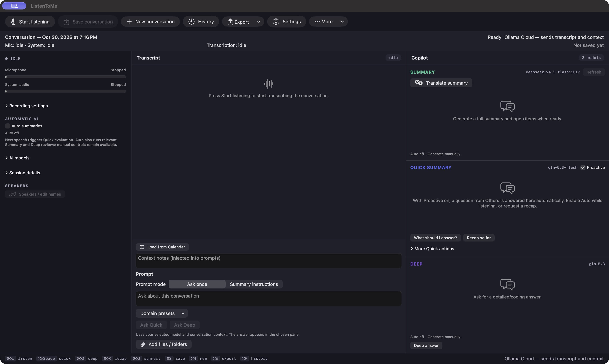</a>

[Expanded model choices and all six secondary actions](../../docs/images/workspace/unreleased-2026-10-30/mac-options.png)
remain available through native disclosures.

**iPhone · full summary and Duo reading**

<a href="../../docs/images/workspace/unreleased-2026-10-30/iphone-live.png">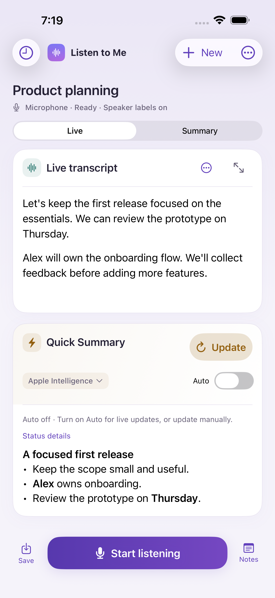</a>
<a href="../../docs/images/workspace/unreleased-2026-10-30/iphone-summary.png">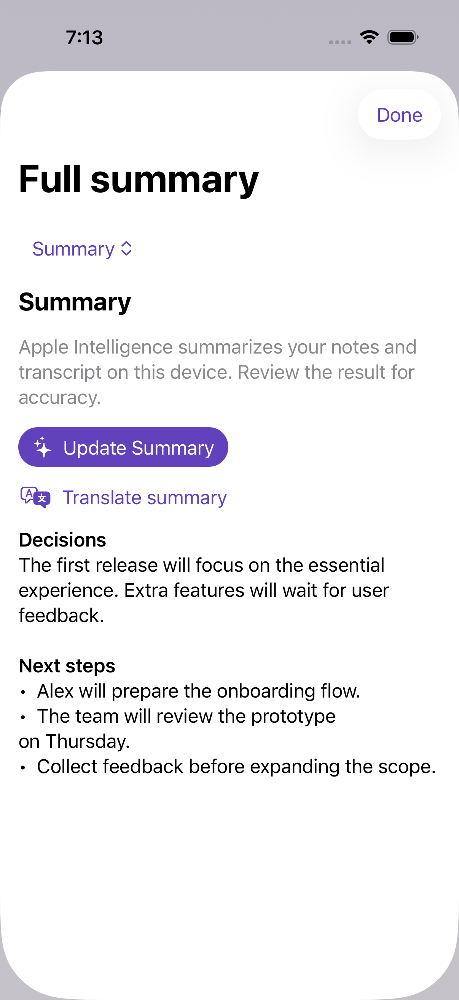</a>

<a href="../../docs/images/workspace/unreleased-2026-10-30/iphone-duo.png">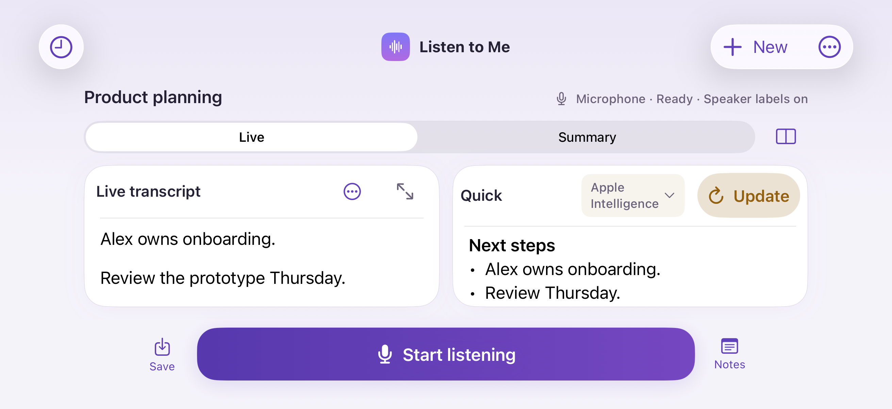</a>

**iPad · transcript and summaries together**

<a href="../../docs/images/workspace/unreleased-2026-10-30/ipad-wide.png">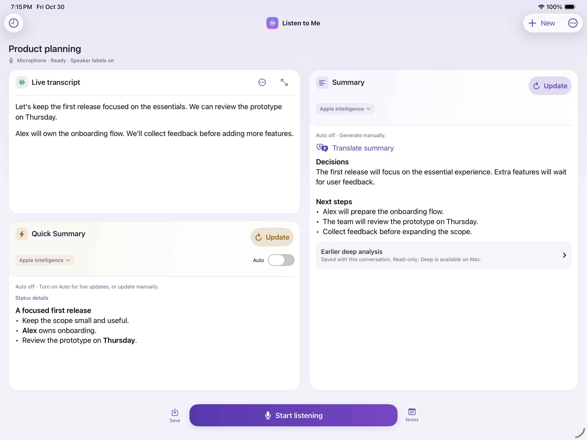</a>

[Compact iPad mini layout](../../docs/images/workspace/unreleased-2026-10-30/ipad-mini.png) keeps transcript
and Quick Summary side by side in its narrower window.

**Watch · local recording and the separate iPhone remote**

<a href="../../docs/images/workspace/unreleased-2026-10-30/watch-home.png">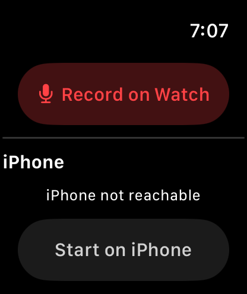</a>
<a href="../../docs/images/workspace/unreleased-2026-10-30/watch-recording.png">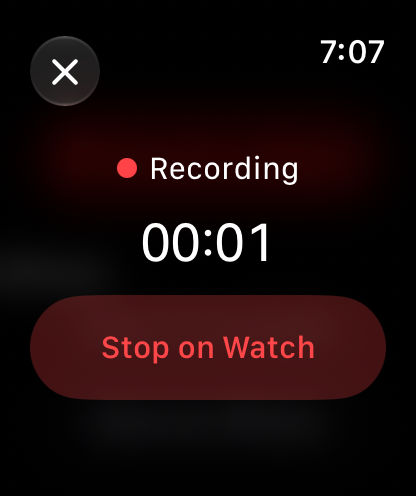</a>

Simulator summaries and Watch recording use explicit synthetic fixtures. The Live previews inject
synthetic summaries and simulated Auto; in normal use, Apple Intelligence supports manual
Generate/Update, while Auto requires a configured supported service. These images establish
layout, not real model quality, physical recording or paired transfer. No Apple listing upload or
release is implied.

Earlier speaker-name, History and TestFlight galleries · source-specific acceptance

### Mac speaker-name acceptance · before workspace refinement

Long names stay within their column while complete transcript lines remain readable. These actual
signed Dev-app captures use synthetic content with AI off and predate the workspace refinement above.
The contained-name behavior is **unreleased**; these images preserve its source-specific acceptance.
[Source, native pixels and acceptance scope](../../docs/images/mac/speaker-rename-unreleased-2026-10-30/manifest.json).

<a href="../../docs/images/mac/speaker-rename-unreleased-2026-10-30/109-wide.png">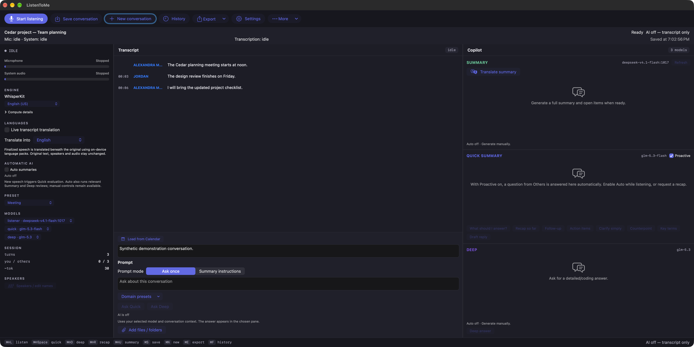</a>

The same conversation in a narrower window

<a href="../../docs/images/mac/speaker-rename-unreleased-2026-10-30/110-narrow.png">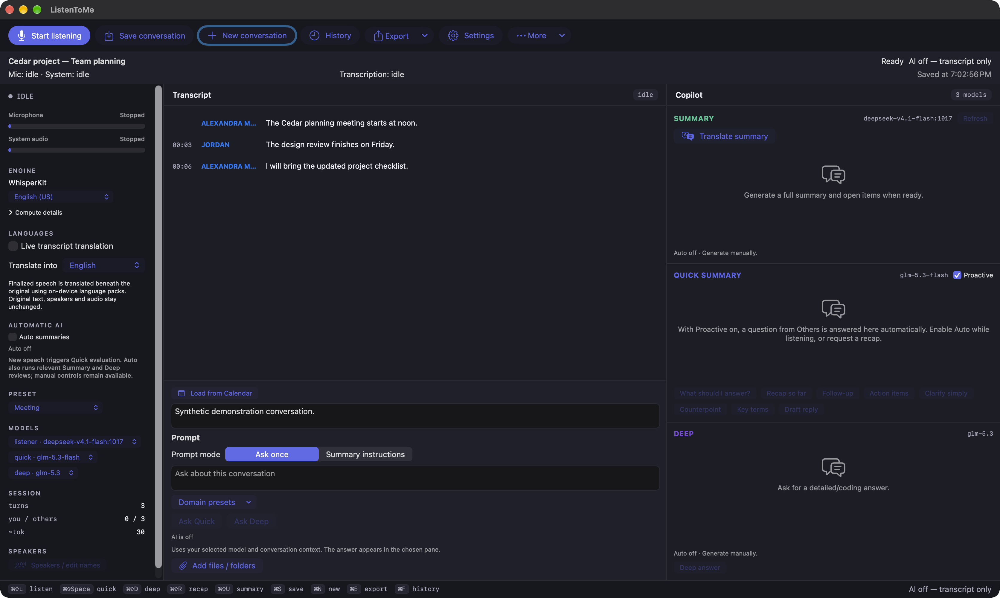</a>

### Unreleased local History refresh

These native previews show an **unreleased follow-up**, not the accepted TestFlight 1.20.3 (43)
binary. Refresh rebuilds local search data without downloading models or changing conversations.
[Source, original pixels and scope](../../docs/images/history/unreleased-2026-10-30/manifest.json) ·
[Behavior and validation](../../docs/history-local-refresh.md).

<table>
  <tr><th align="center">iPhone · active search</th><th align="center">iPhone · empty History</th></tr>
  <tr>
    <td align="center"><a href="../../docs/images/history/unreleased-2026-10-30/iphone-history.png">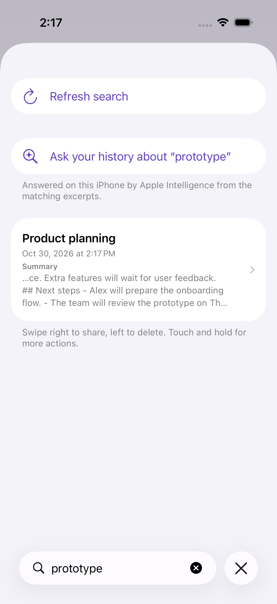</a></td>
    <td align="center"><a href="../../docs/images/history/unreleased-2026-10-30/iphone-empty-history.png">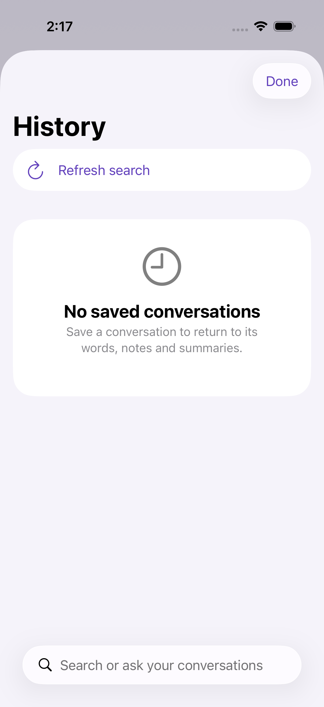</a></td>
  </tr>
</table>

Search is active in the first image, so its navigation title is intentionally hidden. The excerpt's
ellipsis is the normal bounded preview.

**iPhone landscape · unqueried History**

<a href="../../docs/images/history/unreleased-2026-10-30/iphone-history-landscape.png">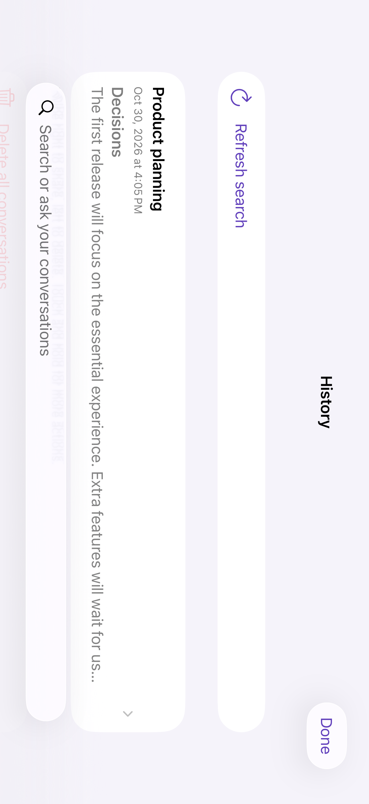</a>

Normal landscape History; scroll for additional actions. The summary excerpt keeps its intended ellipsis.

**iPad wide · unqueried History**

<a href="../../docs/images/history/unreleased-2026-10-30/ipad-history-wide.png">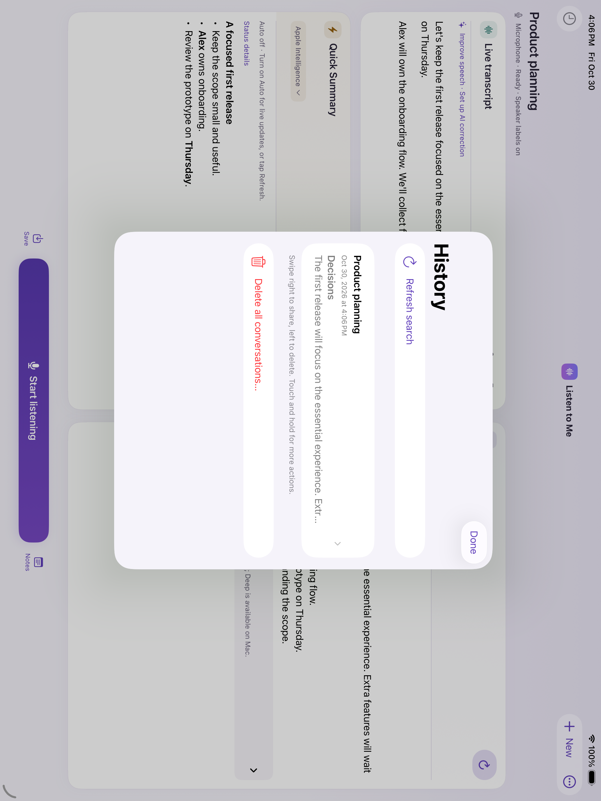</a>

**Mac · actual installed History**

<a href="../../docs/images/history/unreleased-2026-10-30/mac-history-sheet.png">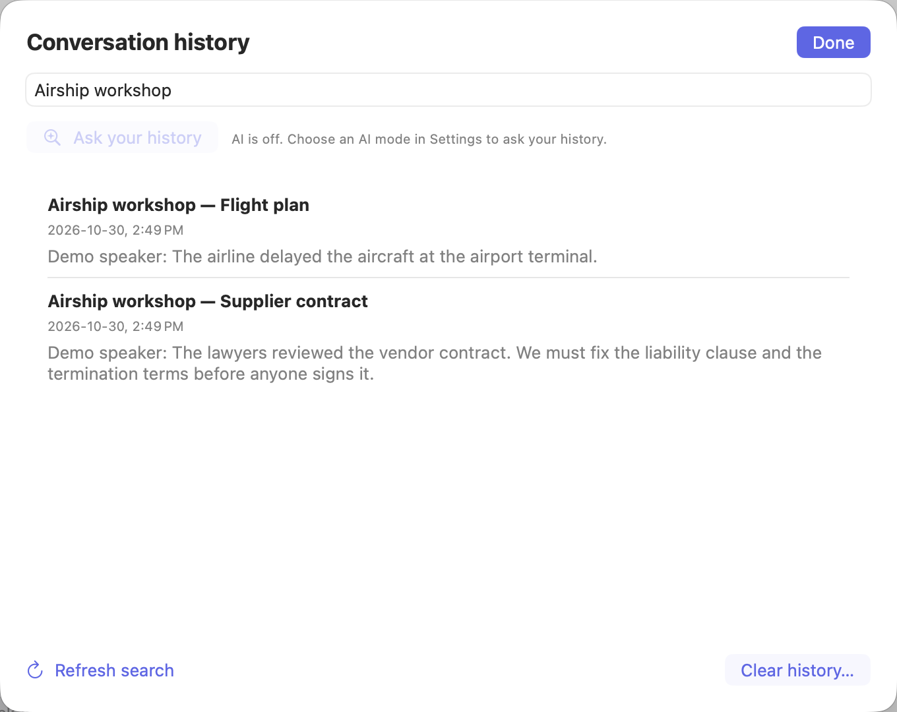</a>

Native sheet-region capture from the signed Dev app, with synthetic content and AI off.
[Full installed window](../../docs/images/history/unreleased-2026-10-30/mac-history-window.png) ·
[Source, native pixels and acceptance scope](../../docs/images/history/unreleased-2026-10-30/manifest.json).

Mac recovery control · isolated native test host

This is the actual shared control rendered in a native host, **not a full installed Mac app**.
The installed History images above are separate full-app acceptance; this component shows the
recovery state exercised in the native test.

<a href="../../docs/images/history/unreleased-2026-10-30/mac-recovery-control.png">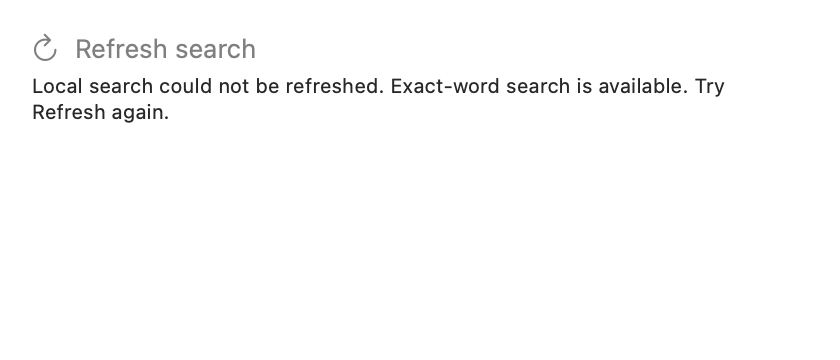</a>

**iPhone, iPad and Apple Watch · TestFlight 1.20.3 (43)**

Fresh native simulator previews from candidate source `8dc8dd3`, using synthetic demonstration
content. Tap an image for the unchanged full-resolution original. All **57 images across seven
device profiles** were inspected; the seven previews below passed visual selection. Their app inputs
match published source `97ef2461`. Apple accepted build 43; these images have not been uploaded to
Apple's listing or attached as GitHub release assets.
[Capture source, checksums and all visual assessments](../../docs/images/ios/release-1.20.3/manifest.json) ·
[Release notes and What to Test](https://github.com/tomqwu/ListenToMe/releases/tag/ios-v1.20.3-build43).

### iPhone

<table>
  <tr>
    <th align="center">Live translation</th>
    <th align="center">Conversation instructions</th>
  </tr>
  <tr>
    <td align="center"><a href="../../docs/images/ios/release-1.20.3/01-iphone-translation.png">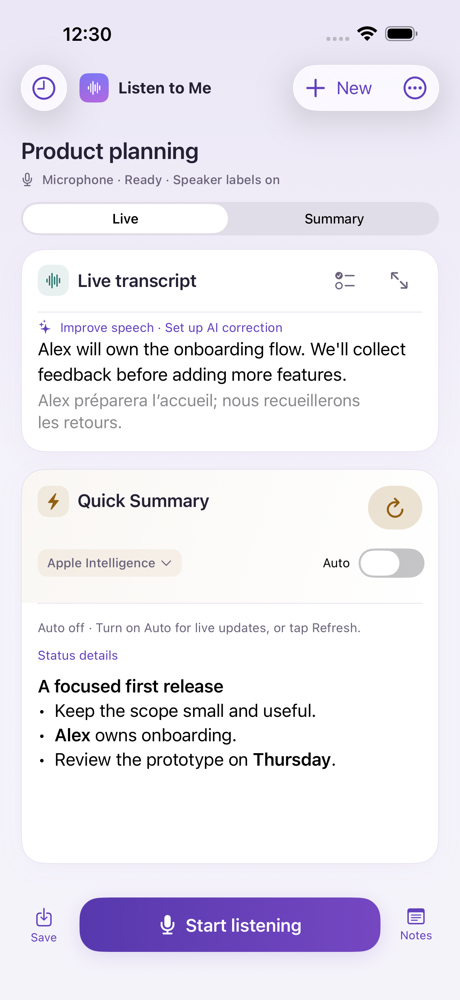</a></td>
    <td align="center"><a href="../../docs/images/ios/release-1.20.3/02-iphone-prompt.png">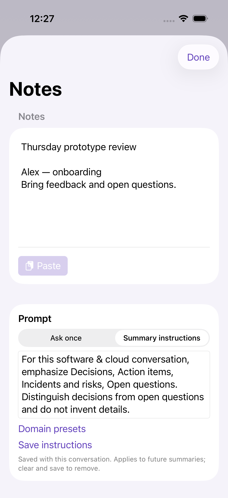</a></td>
  </tr>
</table>

**Duo / landscape**

  
   Follow the transcript and Quick answer together.

### iPad

  <a href="../../docs/images/ios/release-1.20.3/04-ipad-summary.png">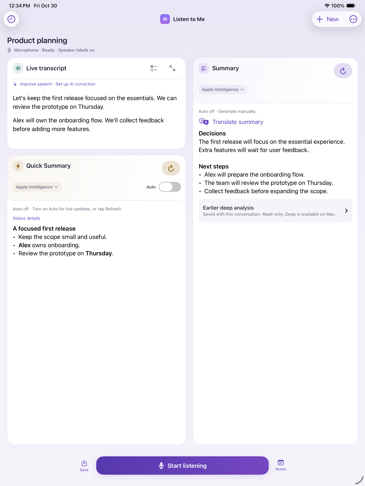</a>
   iPad Pro: transcript, Quick Summary and decisions in one workspace.

  <a href="../../docs/images/ios/release-1.20.3/05-ipad-wide.png">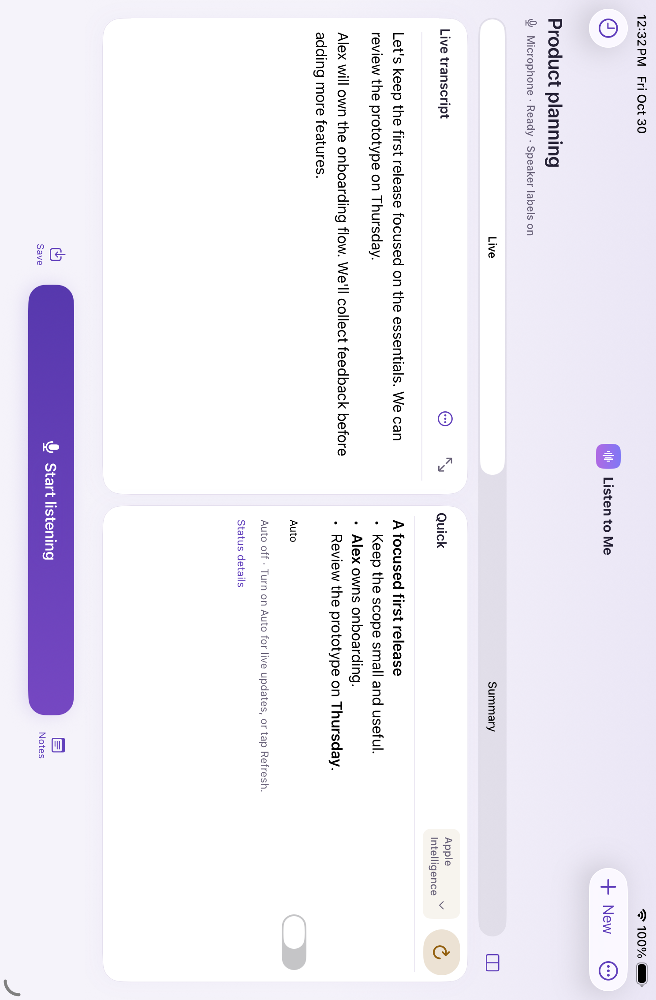</a>
   iPad mini: a wide view of the conversation and its key points.

### Apple Watch

<table>
  <tr>
    <th align="center">46 mm</th>
    <th align="center">Ultra · 49 mm</th>
  </tr>
  <tr>
    <td align="center"><a href="../../docs/images/ios/release-1.20.3/06-watch-46-recording.png">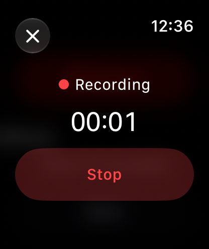</a></td>
    <td align="center"><a href="../../docs/images/ios/release-1.20.3/07-watch-49-recording.png">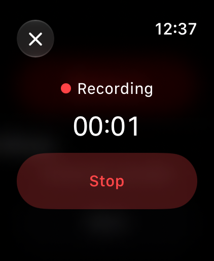</a></td>
  </tr>
</table>

These synthetic previews do not establish physical microphone, wrist-down, paired-transfer or
real translation-quality acceptance. Mac screenshots remain historical below; no Mac release is claimed.

Previous TestFlight 1.20.2 (42) and October 30 Duo checkpoint

**iPhone, iPad and Apple Watch · TestFlight 1.20.2 (42)**

Native app previews use synthetic demonstration content; tap an image to view it at full resolution.
The six release assets have recorded download/checksum verification. These previews do not update
Apple's listing or establish physical-device or translation-quality acceptance.
[Release notes and What to Test](https://github.com/tomqwu/ListenToMe/releases/tag/ios-v1.20.2-build42) ·
[Capture source and all 65 reviewed images](../../docs/images/ios/release-1.20.2-en-US.json).

### iPhone

<table>
  <tr>
    <th align="center">Live translation</th>
    <th align="center">Translation options</th>
  </tr>
  <tr>
    <td align="center"></td>
    <td align="center"></td>
  </tr>
</table>

**Duo / landscape · historical October 30 candidate checkpoint**

  <a href="../../docs/images/ios/candidate-2026-10-30/iphone-duo.png">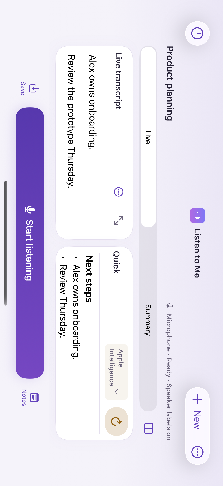</a>
   Follow the transcript and Quick answer together, with recording and Notes controls in reach.

Native iPhone 17 Pro preview from `cb4cd31`, using a short synthetic example in the real app views.
The candidate improves compact-landscape spacing; the Pro and Pro Max focused runs passed six tests.
Configured version 1.20.2 (42) is unreleased candidate source, separate from the published build-42
images above; no new binary or App Store media upload is claimed.
[Capture source, native resolution and test evidence](../../docs/images/ios/candidate-2026-10-30/manifest.json).

### iPad

  
   Summary translation with the original kept alongside.

  
   Wide workspace for following the conversation and its summaries.

### Apple Watch

<table>
  <tr>
    <th align="center">46 mm</th>
    <th align="center">Ultra · 49 mm</th>
  </tr>
  <tr>
    <td align="center"></td>
    <td align="center"></td>
  </tr>
</table>

Simulated recording controls; physical microphone, wrist-down and paired-transfer acceptance are separate.

Historical Mac and iPhone/iPad layouts

**iPhone Duo · October 29 candidate checkpoint**

This earlier Pro Max preview from `f3b35f4` used a concise synthetic fixture without changing
production layout at that checkpoint. It predates the compact-landscape spacing fix above.
[Original capture manifest](../../docs/images/ios/candidate-2026-10-29/manifest.json).

  <a href="../../docs/images/ios/candidate-2026-10-29/iphone-duo.png">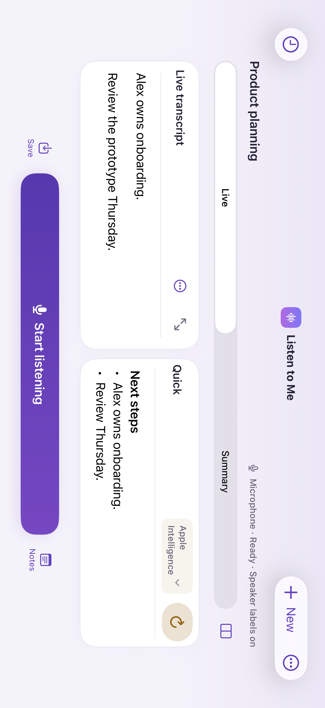</a>

**macOS · historical workspace**

This older capture is retained for reference; it does not depict the latest Mac candidate.
Current unreleased Mac previews appear above.

  

**iPhone and iPad · 1.18.2**

These older simulator captures use synthetic content. The Duo image includes partially scrolled
content and is historical QA, not a clean current release preview.
[Capture provenance](../../docs/images/ios/release-1.18.2-en-US.json).

  
  
  

  
   Earlier two-pane iPhone layout.

  

  

